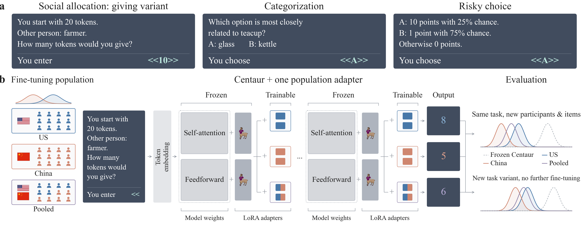

# Sampling Bias in Foundation Models of Human Cognition

Large language models fine-tuned on behavioral data have been proposed as
foundation models of human cognition. However, sampling bias in the training
data may limit whose behavior they represent. This project examines how the
population used for behavioral fine-tuning shapes a model's predictions, and
whether these effects extend to an untrained task variant.

[Paper source](paper/) · [Data documentation](data/README.md) ·
[Reproduction guide](REPRODUCING.txt)

## Approach

We use responses from US and Chinese participants in three domains: social
allocation, categorization, and risky choice. Starting from the same
[Centaur](https://github.com/marcelbinz/Llama-3.1-Centaur-70B) model, we train
additional LoRA adapters on US responses, Chinese responses, or an equal mix of
both. The original model remains frozen, and training sample sizes, prompts,
and settings are matched across population conditions.

We evaluate predictions on participants and items excluded from fine-tuning.
For social allocation, we also test transfer from giving tokens to taking
tokens, a task variant excluded from training. Comparisons with frozen Centaur,
base Llama, and a simple adjustment of overall answer preferences help separate
changes in predictions from gains in predictive accuracy.



*Task examples and study design. The model outputs in this schematic are illustrative.*

## Main findings

- **The fine-tuning population changes predictions.** US and Chinese training
  samples produced different predictions on held-out items across all three
  datasets. Pooled training produced intermediate mean predictions.
- **Prediction shifts can transfer without capturing the human difference.**
  The US adapter predicted both more tokens given and more tokens taken than
  the Chinese adapter, although these responses have opposite meanings for
  generosity. Predictive accuracy improved over frozen Centaur on Taking, but
  the model difference ran opposite to the observed human population difference.
- **Fine-tuning does not consistently outperform simpler controls.** Its gains
  over an adjustment of overall answer preferences depended on the task and
  population.

These results highlight why population coverage matters when interpreting a
model as representative of human cognition. Better prediction scores alone do
not establish that it captures population differences. The study covers three
datasets from two countries and a closely related task variant; broader
generalization remains an open question.

## Reproduce the results

Use Python 3.10–3.12. From this folder:

```bash
python3 -m venv .venv
source .venv/bin/activate
python -m pip install -r requirements.txt
make results figures test
```

This checks the saved results, rebuilds the six paper figures, and runs the tests
without a GPU or model download. Outputs go to `build/results/` and `paper/figures/`.

To repeat the analyses from participant responses and saved model predictions:

```bash
make data
make analysis
```

## Data and training

The repository includes data preparation, training, evaluation, analysis, and
plotting code, together with prepared responses, participant splits, prompts,
saved model predictions, and training records. The saved predictions allow the
analyses to be reproduced without retraining the models.

Model weights are not included. The [data documentation](data/README.md) links
to the source studies and describes the file formats. The
[reproduction guide](REPRODUCING.txt) provides GPU training commands and the
recorded software environments.
